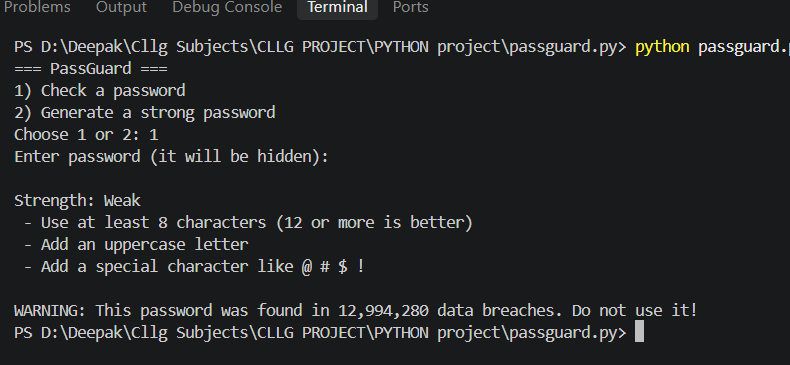
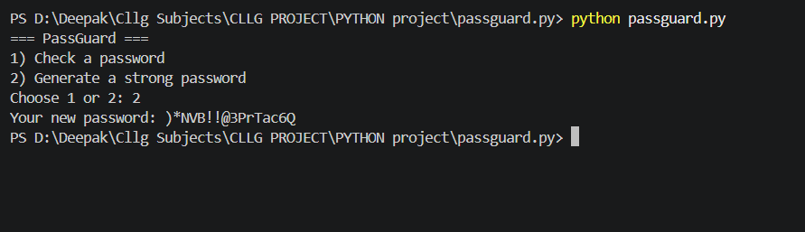

# PassGuard - Password Strength Checker

A simple Python tool that checks how strong a password is, tells you if it has appeared in known data breaches, and can generate a strong random password.

## Problem Statement
Many people use weak or reused passwords, which is one of the biggest causes of hacked accounts.

## Objective
To help users check their password strength, get tips to improve it, and create strong passwords safely.

## Features
- **Strength checker**: shows Weak / Moderate / Strong based on length, uppercase, lowercase, numbers and symbols
- **Tips**: tells you what to add to make the password better
- **Breach check**: checks if the password appeared in known data breaches (using the Have I Been Pwned API)
- **Password generator**: creates a strong random password

## How the Breach Check Works
Your password is converted to a SHA-1 hash, and only the **first 5 characters** of that hash are sent to the API. The full password never leaves your computer (this is called k-anonymity).

## How to Run
1. Install Python 3
2. Install the requirement:
   ```
   pip install -r requirements.txt
   ```
3. Run the program:
   ```
   python passguard.py
   ```

## Screenshots

**Checking a password**



**Generating a strong password**



## Future Improvements
- Add a GUI using Tkinter
- Add password entropy calculation
- Save a report of the result

## Technologies Used
Python, requests, hashlib, secrets

## Author
Deepak - BTech First Year, NGF College, Palwal

## License
MIT License
